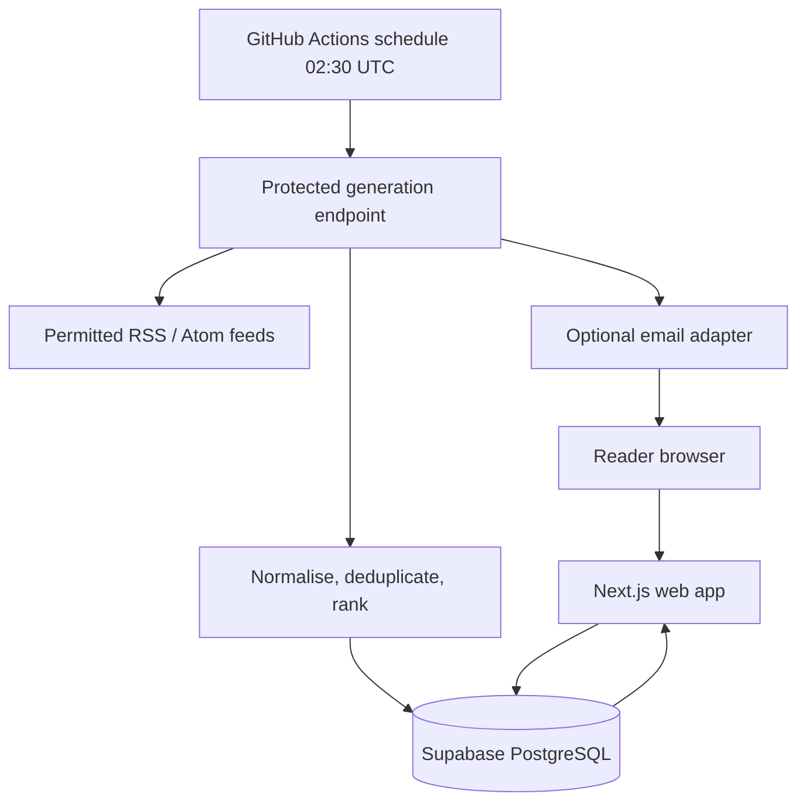

# 02 — Technical Requirements Document (TRD)
**Goal:** implement the PRD with the smallest maintainable zero-cost-first stack.

## 1. Architecture

### Preferred MVP stack
| Layer | Choice | Rationale |
|---|---|---|
| App | Next.js App Router + React + TypeScript strict | One repository for UI and server routes |
| Styling | Tailwind CSS using design tokens | Consistent responsive UI |
| Validation | Zod | Validate preferences, API input and provider data |
| Database | Supabase PostgreSQL | Hosted relational storage and optional Auth |
| Data access | Supabase JS initially; avoid adding an ORM until needed | Fewer moving parts for an MVP |
| Feed parsing | Server-only RSS/Atom parser | No browser-side feed secrets or CORS dependency |
| Scheduler | GitHub Actions scheduled workflow calling a protected endpoint, or invoking a runner | Simple free-tier starting point; best-effort timing |
| Hosting | Vercel free tier or equivalent | Easy Next.js deployment, subject to provider terms |
| Email | Optional provider adapter | App must work without email |
| AI summaries | Optional interface; disabled by default | Avoid mandatory paid API costs |

The supplied PDF proposes a broader stack including Next.js, TypeScript, Tailwind, Supabase/Neon, Drizzle, TanStack Query, Zustand, n8n/Make and Resend. For this personal MVP, avoid adopting every tool at once. Add Drizzle, n8n or an AI provider only when there is a concrete requirement that justifies their additional setup and quotas.

### System diagram

## 2. Editorial data pipeline and ranking
The editorial mission in `docs/07_AI_STUDENT_EDITORIAL_POLICY.md` is binding. Tag stories by category (models/releases, developer tools, research, open source, infrastructure/safety, student action). Apply the documented 0–100 relevance scoring and penalties, freshness windows, canonical URL deduplication, publisher diversity and source-quality checks. Keep vendor claims attributed and do not label models open-source without license evidence. Store source and summary provenance so the UI can distinguish source snippets from AI-generated summaries.

## 3. Data model
Use UUID primary keys generated by the database. All timestamps are stored as `timestamptz` in UTC; issue date is a local date for the configured timezone.

### `profiles`
- `id uuid primary key` — references the auth user if Supabase Auth is enabled.
- `display_name text`
- `timezone text not null default 'Asia/Kolkata'`
- `language text not null default 'en'`
- `topics text[] not null default '{}'`
- `regions text[] not null default '{}'`
- `daily_story_limit integer not null default 30` — check 5–100.
- `email_enabled boolean not null default false`
- `created_at timestamptz not null default now()`
- `updated_at timestamptz not null default now()`

### `sources`
- `id uuid primary key default gen_random_uuid()`
- `name text not null`
- `feed_url text not null unique`
- `category text not null`
- `language text not null default 'en'`
- `region text`
- `enabled boolean not null default true`
- `last_checked_at timestamptz`
- `last_success_at timestamptz`
- `last_error text`
- `created_at timestamptz not null default now()`

### `articles`
- `id uuid primary key default gen_random_uuid()`
- `source_id uuid not null references sources(id)`
- `canonical_url text not null unique`
- `title text not null`
- `description text`
- `author text`
- `published_at timestamptz`
- `fetched_at timestamptz not null default now()`
- `language text`
- `category text`
- `content_hash text`
- `created_at timestamptz not null default now()`

### `editions`
- `id uuid primary key default gen_random_uuid()`
- `issue_date date not null`
- `timezone text not null default 'Asia/Kolkata'`
- `status text not null check (status in ('building','ready','partial','failed'))`
- `headline text`
- `generated_at timestamptz`
- `article_count integer not null default 0`
- `generation_run_id uuid`
- `created_at timestamptz not null default now()`
- Unique constraint on `(issue_date, timezone)` for a single edition per date/timezone in personal MVP mode.

### `edition_stories`
- `edition_id uuid not null references editions(id) on delete cascade`
- `article_id uuid not null references articles(id) on delete cascade`
- `rank integer not null`
- `section text not null`
- `summary text`
- `summary_kind text not null default 'source_snippet' check (summary_kind in ('source_snippet','ai_generated','editorial'))`
- Primary key `(edition_id, article_id)`; unique `(edition_id, rank)`.

### `generation_runs`
- `id uuid primary key default gen_random_uuid()`
- `started_at timestamptz not null default now()`
- `finished_at timestamptz`
- `trigger text not null check (trigger in ('scheduled','manual'))`
- `status text not null check (status in ('running','succeeded','partial','failed'))`
- `feeds_attempted integer not null default 0`
- `feeds_succeeded integer not null default 0`
- `articles_ingested integer not null default 0`
- `error_summary text`
- `created_at timestamptz not null default now()`

### `delivery_logs` (optional email)
- `id uuid primary key default gen_random_uuid()`
- `edition_id uuid not null references editions(id) on delete cascade`
- `channel text not null check (channel in ('email'))`
- `recipient_hash text`
- `status text not null check (status in ('pending','sent','failed','skipped'))`
- `provider_message_id text`
- `error_summary text`
- `created_at timestamptz not null default now()`

Create indexes for `articles(published_at desc)`, `articles(source_id)`, `edition_stories(edition_id, rank)`, and `generation_runs(started_at desc)`.

## 3. Security and access
- If this is truly single-user, the simplest MVP can use a private admin secret for generation plus a protected dashboard. Do not expose the secret in client code.
- If Supabase Auth is enabled, enable RLS on user-owned tables and scope profile/edition preference queries to the authenticated user. Do not assume a service-role key is safe in a browser.
- Store `GENERATION_SECRET`, Supabase server credentials and email API keys only in hosting environment settings.
- Compare generation secrets in constant time where practical; reject missing or invalid credentials.
- Validate URLs and allow only `https:`/`http:` feed URLs from an explicit source registry. Add timeout, response-size cap and redirect checks to reduce SSRF risk. Do not accept arbitrary user-supplied feed URLs without safeguards.
- Sanitize/escape feed titles and descriptions as text; never render feed HTML unsafely.
- Apply per-run and per-source timeouts, bounded retries and a maximum article count.
- Do not log secrets, full email addresses or unnecessary personal data.
- Keep `.env.local` out of Git. `.env.example` contains names and placeholders only.

## 4. API contracts
| Route | Method | Purpose | Auth / validation |
|---|---|---|---|
| `/` | GET | Show latest edition | Public only if user intentionally publishes it; otherwise auth-gated |
| `/settings` | GET | Preferences UI | Auth required if accounts are enabled |
| `/api/preferences` | GET/PUT | Read/update preferences | Auth required; Zod schema |
| `/api/editions/latest` | GET | Retrieve latest edition | Same visibility rule as `/` |
| `/api/editions/[date]` | GET | Retrieve an edition | Validate date and access |
| `/api/generate` | POST | Start generation | `Authorization: Bearer <GENERATION_SECRET>`; server-only |
| `/api/health` | GET | Non-sensitive health check | Return status only; no secrets or raw errors |
| `/api/delivery/test` | POST | Test email adapter | Admin/auth required; rate limited |

Return typed JSON shapes and stable error codes. Never return stack traces or secret values to the browser.

## 5. Generation algorithm
1. Create a `generation_runs` row with `running` status.
2. Compute the target issue date in the configured timezone.
3. Load enabled feed sources from the registry.
4. Fetch each source with timeout and bounded response size.
5. Parse RSS/Atom entries; normalise canonical URLs, title, description, publication date and source.
6. Reject entries without a usable title or URL; deduplicate by canonical URL and, secondarily, content hash.
7. Upsert article metadata and track per-source success/failure.
8. Score candidates using topic match, freshness, preferred region/language and source diversity. Keep scoring deterministic and documented.
9. Choose the configured story limit and group into sections.
10. Store edition and story links transactionally or in an idempotent sequence. Re-running the same date must not create duplicates.
11. If at least one source succeeded but some failed, mark the edition/run `partial`; if all sources fail, mark run failed and preserve the previous good edition.
12. If email is configured, send a compact summary/link after the edition is stored. Record delivery result separately.
13. Finalise the run log with counts and timestamps.

## 6. Environment inventory
Required/optional names are in `.env.example`. Validate server environment at startup with Zod. Never prefix private keys with `NEXT_PUBLIC_`.

## 7. Testing requirements
- Unit tests: URL normalisation, deduplication, ranking, issue-date/timezone calculation, RSS parser edge cases.
- Integration tests: database upsert/idempotency, failed feed handling, protected generation endpoint.
- UI tests: empty state, normal edition, partial edition, no email configured, mobile layout.
- Security tests: missing/invalid generation secret, unsafe feed URLs, oversized responses, HTML injection in feed metadata.
- Release checks: lint, typecheck, test suite and production build.
