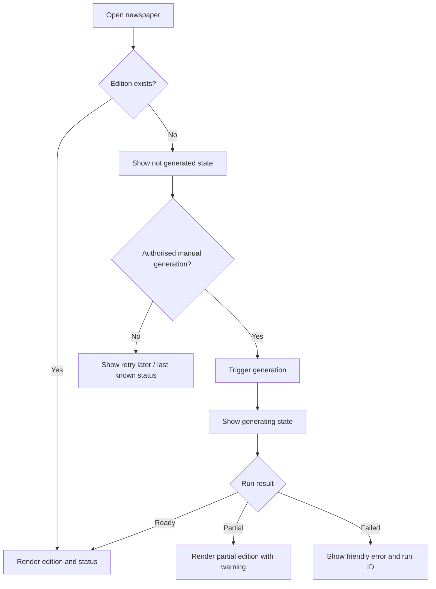
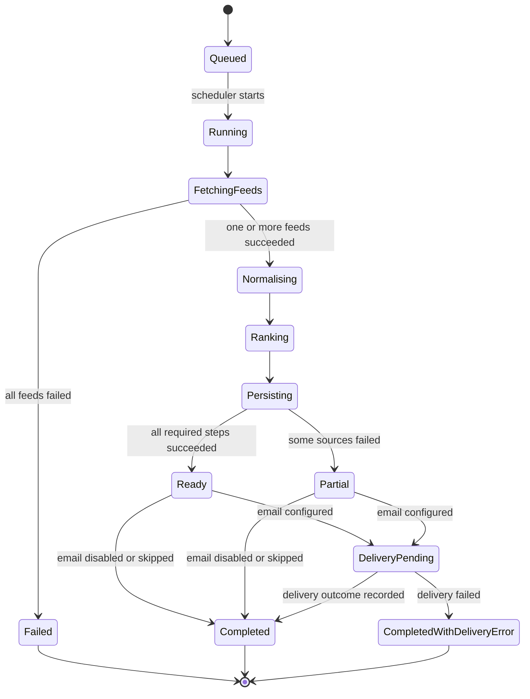

# 04 — App Flow, Routes and State Machines

## 1. Route topology
| Route | Auth | Shell | Rendering |
|---|---|---|---|
| `/` | Public only if edition is intended public; otherwise auth | Editorial shell | Server-rendered latest edition |
| `/login` | Anonymous | Auth shell | Server/client as required |
| `/settings` | Required in multi-user mode | App shell | Server page + interactive form |
| `/history` | Required if private | App shell | Server-rendered list |
| `/history/[date]` | Same as edition visibility | Editorial shell | Server-rendered edition |
| `/admin/sources` | Admin only | Admin shell | Server page |
| `/admin/runs` | Admin only | Admin shell | Server page |
| `/api/generate` | Protected server secret | None | POST only |
| `/api/health` | Public minimal health or protected | None | GET |
| `/api/preferences` | User auth | None | GET/PUT |

## 2. Main edition flow

## 3. Scheduled generation state machine

## 4. Interaction matrix
| Screen | Trigger | Action | Pending state | Error/recovery |
|---|---|---|---|---|
| Edition | Select topic chip | Filter stories in view | Subtle loading if server request needed | Keep current edition and show retry |
| Settings | Save preferences | Validate and persist | Disable Save; show saving label | Inline field errors; preserve form values |
| Admin sources | Enable/disable source | Update source registry | Row shows updating | Roll back toggle and show message |
| Admin runs | Generate now | POST to protected server action | Show run started and disable duplicate trigger | Display run ID; allow retry after completion |
| Edition story | Read source | Open original URL in new tab | None | If URL invalid, do not render link |
| History | Select date | Load edition | Skeleton | Friendly not-found state |
| Email setting | Toggle email | Validate address/provider setup | Saving state | Keep disabled and explain missing configuration |

## 5. Overlay/toast registry
- Toast: preferences saved, generation queued, edition generated, email sent/failed.
- Confirmation dialog: manual generation if it may consume provider quota; explain that it may take a few minutes.
- No modal should be required just to read a story.
- All overlays close with Escape where appropriate; focus returns to trigger.

## 6. Failure behavior
- A single feed failure must not abort successful feeds.
- All feeds failing must not overwrite a previous good edition with an empty edition.
- Generation endpoint must reject unauthenticated calls and duplicate concurrent runs.
- A rerun for the same date must be idempotent.
- If scheduler runs late, record actual start time and show actual generation time; never claim it ran at exactly 08:00.
- If email delivery fails, the in-app edition remains available.
- If no AI provider is configured, use source snippets and continue.
